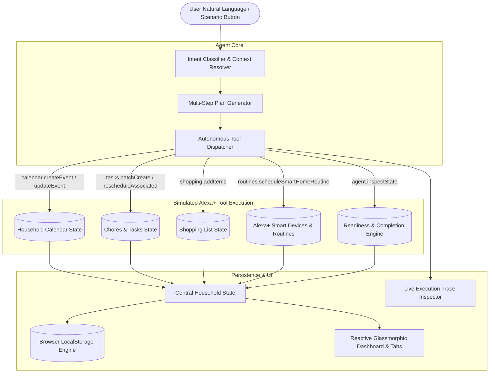

# HomeHandoff — AI Household Planner 🏡✨

> Coordinate household tasks, visits, shopping lists, and smart-home routines with HomeHandoff, a context-aware household planning demo built for the **Amazon Developer Hackathon (Alexa+ Track)**.

[](https://vitejs.dev/)
[](https://react.dev/)
[](https://www.typescriptlang.org/)
[](https://vitest.dev/)
[](./LICENSE)

---

## 🌟 Product Summary

When family visits or major household events occur, preparing a home requires juggling multiple fragmented surfaces: calendars, family text threads, chore assignments, grocery lists, and smart home appliances. 

**HomeHandoff** is an intelligent, context-aware household coordination agent built for the **Alexa+ web-experience route**. It transforms natural language instructions into coordinated multi-step action plans: blocking calendar arrival windows, delegating categorized tasks to family members with preparation buffers, stocking guest amenities into shopping lists, and automating smart home climate, lighting, and access controls.

Unlike generic conversational chatbots that merely output blocks of decorative text, **HomeHandoff's tool calls actually mutate application state** across all modules with real-time execution traces and persistent browser state.

<!-- Live Demo: When deployed to Vercel, Netlify, or AWS Amplify, insert your production URL here:
Live Demo: [https://your-domain.vercel.app](https://your-domain.vercel.app)
-->

---

## 🛡️ Honest Disclosure of Simulated Alexa+ Integrations

> [!IMPORTANT]
> **Hackathon Submission Route:**  
> This project implements the officially permitted **simulated Alexa+ web-experience route** for the Amazon Developer Hackathon.
> 
> To ensure total transparency for judges, **none of the simulated integrations claim to be live Amazon cloud services** or require paid API credentials. Instead, HomeHandoff implements high-fidelity deterministic client simulation of Alexa APIs:
> 
> 1. **Simulated Alexa Voice Service (AVS) & Agent:** Natural language intent classifier with multi-turn context memory, autonomous tool execution dispatching, and optional browser voice synthesis via the Web Speech API.
> 2. **Simulated Alexa Smart Home Skills API:** Orchestrates connected device fleet states, including Ecobee smart thermostats (pre-conditioning guest rooms to 71°F), Philips Hue lighting scenes ("Warm Welcome"), Schlage smart deadbolts (guest PIN generation), and Roborock robot vacuums.
> 3. **Simulated Alexa Shopping List API:** Synchronizes guest food preferences and bath amenities organized by grocery store aisle.
> 4. **Simulated Alexa Household Calendar:** Blocks out arrival and departure windows with preparation buffers and sync simulation.

---

## 🚀 The 3 Guided Hackathon Scenarios

HomeHandoff includes interactive one-click scenario chips in the Alexa+ conversational interface:

### 1. Scenario 1: Initial Multi-Step Coordination
> **"My parents are visiting Friday. Prepare the house."**
- **Autonomous Tool Calls:**
  - `calendar.createEvent`: Blocks "Parents Weekend Visit" (Friday 6:00 PM – Sunday 3:00 PM).
  - `tasks.batchCreate`: Generates 5 prioritized tasks with assigned family members (bedroom cleaning, bathroom restock, grocery run, entryway tidy, Wi-Fi card setup).
  - `shopping.addItems`: Adds 5 parent-favorite items (artisan sourdough, organic milk, dark roast coffee, chamomile tea, plush bath towels).
  - `routines.scheduleSmartHomeRoutine`: Arms "Parents Arrival Welcome Routine" (pre-cools house to 71°F, sets warm porch lights, and arms simulated guest pass placeholder `SIMULATED-CODE-NOT-ISSUED`; no physical lock contacted).
- **Result:** Generates an active plan, calculates preparation milestones, and sets initial readiness score.

### 2. Scenario 2: Dynamic Timeline & Buffer Rescheduling
> **"Actually, they're arriving Saturday at 5 PM."**
- **Autonomous Tool Calls:**
  - `calendar.updateEvent`: Shifts existing calendar block forward to Saturday 5:00 PM.
  - `tasks.rescheduleAssociated`: Intelligently shifts all associated cleaning and grocery deadlines forward into Saturday morning/afternoon so groceries and cleaning stay fresh right before arrival.
  - `routines.updateRoutineTrigger`: Adjusts smart home routine trigger to Saturday 3:30 PM (preserving the 90-minute pre-arrival buffer).
- **Result:** Preserves plan context from memory, updates dates across all modules, and recalculates timeline.

### 3. Scenario 3: Real-Time Readiness Inspection
> **"What still needs doing before they arrive?"**
- **Autonomous Tool Calls:**
  - `agent.inspectState`: Evaluates live state of completed vs. open tasks, pending shopping items, and smart routine arming.
- **Result:** Produces an executive readiness report with a dynamic percentage score (e.g. 40% if 2 of 5 tasks are checked off), grouped by family member with estimated remaining minutes.

---

## 🏛️ System Architecture



---

## 📱 Modules & Features

| Module | Description | Key Interactions |
| :--- | :--- | :--- |
| **💬 Assistant** | Restrained conversation interface with 3 prominent guided scenarios, clean message bubbles, collapsible simulated tool traces, and optional speech output. | One-click scenario launches, message speech synthesis, inline tool payload inspection. |
| **📊 Dashboard** | Household command center with horizontal task preparation progress bar, next deadline card, pending shopping counters, and priority chore board. | Live preparation completion progress bar, direct task completion toggles, quick module navigation. |
| **📅 Calendar** | Family schedule, visitor arrival blocks, and preparation windows. | Filter by Visitor / Family / Routine / Errand, validated event creation modal with start/end checks. |
| **📋 Chores & Tasks** | Practical task management categorized by Guest Suite, Cleaning, Groceries, Smart Home. | Assignee filtering (Vaibhav, Sarah, Shared), status filters (Open, Done), priority badges, direct task completion. |
| **🛒 Shopping List** | Department-sorted grocery and guest amenity checklist (Produce, Bakery, Dairy, Pantry, Amenities). | Aisle categorization, check off purchased items, validated add-item modal. |
| **🏡 Smart Routines** | Simulated Alexa Smart Home integration orchestrating Ecobee thermostat, Philips Hue lights, simulated keypad pass, and Roborock vacuum. | Power toggles for scheduled routines, live device state telemetry derived directly from state. |
| **⚡ Audit Trail** | Collapsible technical inspector with simulated latency, status codes, search, filter by tool family, and JSON copy with clipboard fallback. | Filter tools, copy payloads as JSON, verify state mutations. |
| **🔄 Demo Reset** | Quick reset in the top header restoring clean initial seed state. | State reset with immediate interface synchronization and storage wipe. |

---

## 💻 Tech Stack

- **Framework:** React 19 + TypeScript
- **Bundler & Dev Server:** Vite 8
- **Styling:** Vanilla CSS with restrained professional design tokens, warm neutral background (`#f8fafc`), white surfaces, dark slate typography, and ocean/slate blue accent (`#0284c7`). Fully responsive down to ~390px mobile viewports.
- **Icons:** Lucide React (used deliberately and sparingly)
- **Testing:** Vitest automated unit testing suite (39 tests)
- **Linter:** Oxlint (zero errors, zero warnings)
- **Voice Output:** Native browser Web Speech API (`SpeechSynthesis`)

---

## 🛠️ Getting Started

### Prerequisites
- Node.js (v18 or higher recommended, tested on Node v24)
- npm (v9 or higher)

### Installation
Clone the repository and install dependencies:
```bash
git clone https://github.com/VaibhavSoni24/HomeHandoff.git
cd HomeHandoff
npm install
```

### Development Server
Start the local Vite development server:
```bash
npm run dev
```
Open [http://localhost:5173/](http://localhost:5173/) in your web browser.

### Run Automated Tests
Run the Vitest test suite covering date boundaries, intent classification, scenario tool dispatching, and state mutations:
```bash
npm test
```

### Production Build
Compile TypeScript and bundle for production:
```bash
npm run build
```

### Linting
Validate codebase with Oxlint:
```bash
npm run lint
```

---

## 🧪 Automated Test Suite

HomeHandoff includes 39 automated unit and regression tests across 4 test suites:
- **`src/test/agentEngine.test.ts` (17 tests)**:
  - **Scenario 1:** Verifies autonomous execution of 4 tools (`calendar.createEvent`, `tasks.batchCreate`, `shopping.addItems`, `routines.scheduleSmartHomeRoutine`), ensuring created entities are committed to the state store.
  - **Scenario 2:** Verifies context retention, event shifting to Saturday 5:00 PM, task deadline recalibration, and routine trigger updating to Saturday 3:30 PM.
  - **Scenario 3:** Verifies dynamic readiness calculation (0% initial, 40% after marking tasks completed, accurate incomplete task enumeration).
  - **Phrasing Variations:** Tests alternate natural language expressions across all 3 scenarios.
  - **Rescheduling Isolation:** Ensures rescheduling only touches the active plan while preserving completed task states, unrelated chores, calendar events, and smart routines.
  - **Missing Plan & Fallbacks:** Graceful responses without crashing when no plan is active or for unrelated queries.
  - **Rapid State Updates:** Validates state consistency during sequential operations and tool tracking.
  - **Complete Pipeline:** Verifies end-to-end parents-visit → task completion → reschedule → readiness inspection.
  - **No Hardcoded PIN:** Confirms literal PIN 8492 never appears in state or tool traces, and verifies presence of placeholder `SIMULATED-CODE-NOT-ISSUED` and no-lock disclosure.
  - **Explicit Date Reschedule:** Verifies moving visit to explicit calendar date (e.g., November 14, 2026 at 5 PM), preserving event duration and pre-arrival buffers.
  - **Data Preservation:** Verifies completed tasks and unrelated household events/chores remain intact during explicit-date rescheduling.
  - **Impossible Date Rejection:** Rejects impossible dates (e.g., February 31) without crashing or JavaScript date rollover.
  - **Ambiguity & Past Dates:** Handles ambiguous reschedule requests and dates in the past with helpful clarifications.
  - **Natural Language Tasks (`ADD_TASK`):** Validates conversational task creation with assignees and priorities.
  - **Natural Language Calendar (`CREATE_CALENDAR_EVENT`):** Validates calendar event scheduling with date/time extraction.
  - **Demo Reset:** Tests clean reset of state and execution trace after all 3 guided scenarios.
- **`src/test/dateUtils.test.ts` (15 tests)**:
  - Tests `getUpcomingDayOfWeek` for same-day future vs. past hour/minute boundaries, tomorrow vs. next week, and date formatting.
  - Tests `getRescheduledDateForPlan` to ensure visit dates never skip an extra week.
  - Tests `parseExplicitDate` for ISO, month-day, and day-month formats.
  - Tests strict calendar validation rejecting impossible dates (Feb 31, April 31, non-leap year Feb 29) while accepting leap year Feb 29.
  - Tests 12-hour and 24-hour time component extraction.
  - Tests `findNextUpcomingEvent` deterministic calculation (empty, past-only, in-progress event, and nearest upcoming).
- **`src/test/readiness.test.ts` (3 tests)**:
  - Tests single-source-of-truth `computePlanReadiness` metrics across active plan and global state.
- **`src/test/storage.test.ts` (4 tests)**:
  - Tests `validateAndSanitizeState` backward compatibility, corruption resilience, localStorage save/load, and demo reset.

---

## 📄 License

This project is licensed under the MIT License — see the [LICENSE](./LICENSE) file for details.

Developed with ❤️ for the **Amazon Developer Hackathon — Alexa+ Track**.
